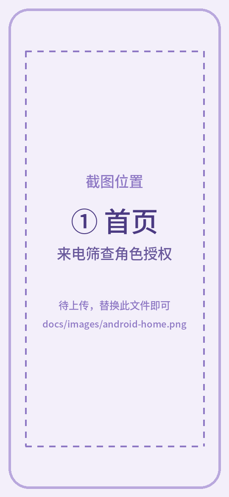
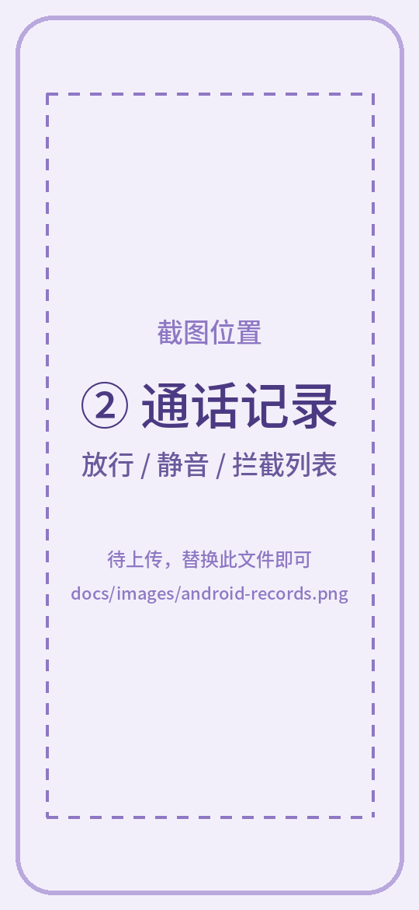
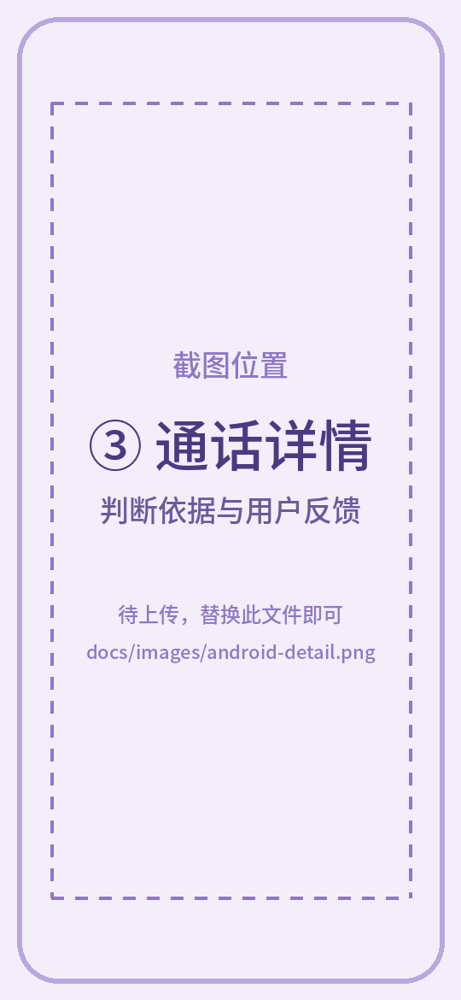
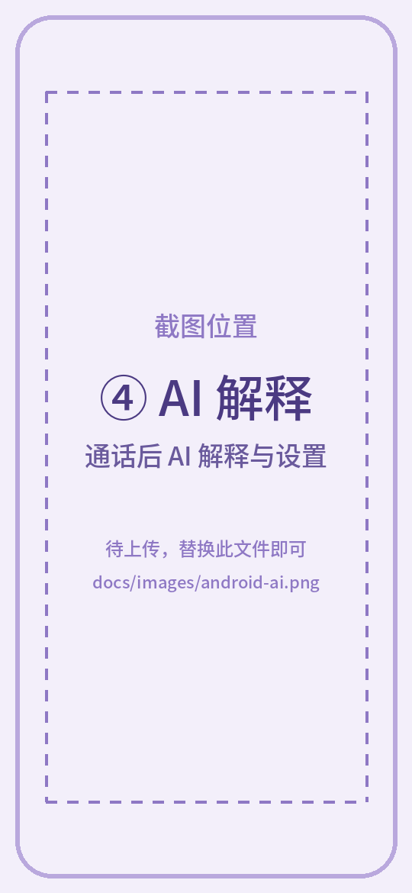
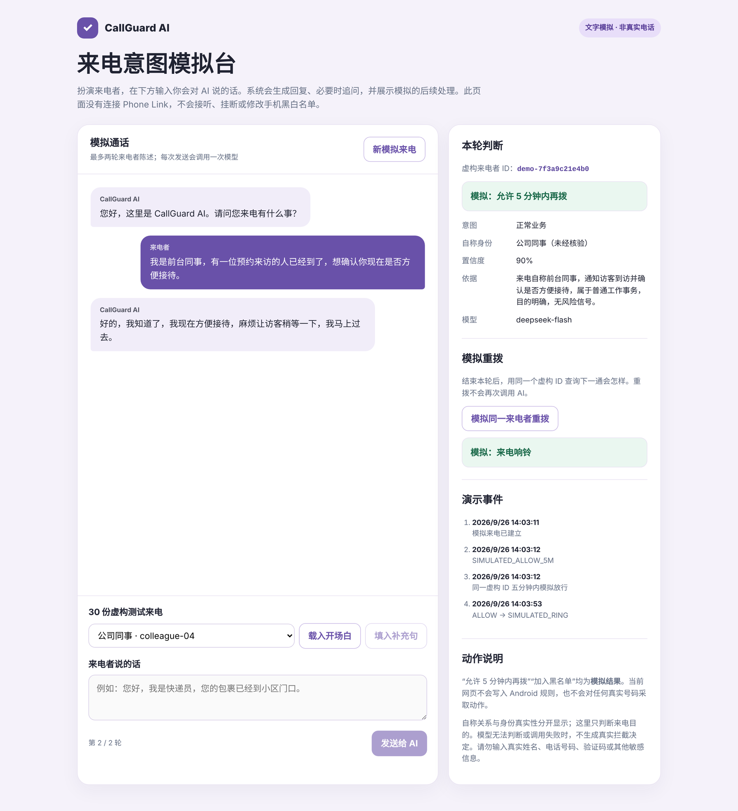
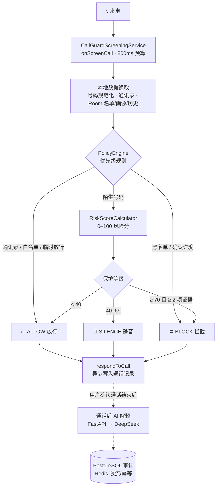

<div align="center">

# 🛡️ CallGuard AI

**安卓智能来电筛查 · 本地规则负责控制，AI 负责理解**

不只判断“这个号码是不是骚扰号码”，而是进一步回答“这个人为什么打电话”。


</div>

---

## 📖 项目简介

骚扰电话、营销电话和 AI 自动拨号越来越多，但“陌生号码一律拦截”又很容易误伤快递、医院、学校老师这类真正重要的电话。号码池技术也让单纯依靠黑名单越来越难。

**CallGuard AI** 是一个分阶段开发的 Android 来电筛查项目，核心思路是：

- 📵 **实时筛查完全在本地完成**：系统来电回调要求几秒内给出结果，所以由确定性的本地规则和风险评分在 **800ms 预算**内决定放行 / 静音 / 拦截，不等待网络、不调用大模型。
- 🧠 **AI 只做“理解”，不直接执行动作**：大模型只输出结构化判断（意图、置信度、依据），最终动作由后端的明确阈值决定；模型调用失败或判断不了时，不会产生拦截决定。
- 🔒 **隐私优先**：数据库里不保存原始号码（只保存设备密钥生成的 HMAC 标识），发送给 AI 的只有有限的数值特征，不含号码、联系人和通话内容。

> [!NOTE]
> 这是一个实验性项目，不是可上架的成品应用。下文的「项目进展」会区分**已经实测**和**尚未验证**的能力。

---

## 📱 手机端界面

<!-- ============================================================
     📷 手机截图位置（共 4 张）
     上传方法：把截图放进 docs/images/，用下面的文件名覆盖占位图即可，
     README 本身不用改。建议竖屏 PNG，宽度 1080 左右。
       ① docs/images/android-home.png     首页（来电筛查角色授权）
       ② docs/images/android-records.png  通话记录列表
       ③ docs/images/android-detail.png   通话详情与反馈按钮
       ④ docs/images/android-ai.png       通话后 AI 解释 / AI 设置
     ⚠️ 上传前请确认截图里没有真实号码、联系人姓名或设备标识；
        如有记录编号等信息，建议打码或用测试数据重新截图。
     ============================================================ -->

<table>
  <tr>
    <td align="center" width="25%"><br><b>① 首页</b><br><sub>来电筛查角色授权</sub></td>
    <td align="center" width="25%"><br><b>② 通话记录</b><br><sub>放行 / 静音 / 拦截列表</sub></td>
    <td align="center" width="25%"><br><b>③ 通话详情</b><br><sub>判断依据与用户反馈</sub></td>
    <td align="center" width="25%"><br><b>④ AI 解释</b><br><sub>通话后 AI 解释与设置</sub></td>
  </tr>
</table>

<!-- 📷 手机截图位置结束 -->

---

## 🖼️ 来电意图模拟台

在真正接入电话语音之前，项目先用一个本机网页**文字模拟**“AI 接听 → 意图判断 → 同一来电者重拨”的完整闭环：你扮演来电者输入一句话，AI 回复并判断来意，后端据此给出模拟动作，再用同一虚构 ID 重拨验证规则是否生效。



<sub>截图为 30 份虚构测试来电中的 `colleague-04`，AI 回复与判断来自评估记录中的真实模型输出。全部为虚构文字，不接入真实电话。</sub>

**模拟动作的判定规则**（由后端决定，而不是模型自己选）：

| 模型判断 | 模拟动作 |
|---|---|
| 正常来电，且置信度 ≥ 0.8 | ✅ 允许同一来电者 5 分钟内再拨 |
| 明确风险，且置信度 ≥ 0.9 | ⛔ 加入模拟黑名单 |
| 自称商家 / 来意不明 / 其他情况 | 🔍 交由用户复核 |
| 第一轮来意不清 | 💬 追问一次（最多两轮） |

### 30 份虚构来电评估

| 样本 | 数量 | 优化前来意判断正确 |
|---|---:|---:|
| 推销 | 10 | 10 |
| 公司同事 | 5 | 4 |
| 老朋友 | 5 | 4 |
| 家人 | 10 | 10 |
| **合计** | **30** | **28**（模拟动作 25/30，误触发黑名单 **0** 次） |

**根据失败样本做的改进**：原来模型把“来意是否清楚”和“自称身份是否可信”混在一起——同事没报文档名、朋友没证明身份，就被降成低置信度。新版把 `intent`（来电目的）和 `claimed_relationship`（自称关系）拆开，并始终标记 `identity_verified=false`；只在来意不清时才追问。对原来失败的 5 份加 2 份代表样本定向复测，**来意、自称关系、模拟动作均 7/7**。

> 新版没有重新跑完整 30 份，因此不宣称新版 30/30，也不代表真实电话准确率。详见 [完整评估与逐段对话](docs/demo-evidence/text-call-evaluation-20260926.md)。

---

## ✨ 已实现的功能

### 📱 Android 端（Kotlin + Jetpack Compose）

- **系统来电筛查角色**：通过 `RoleManager.ROLE_CALL_SCREENING` 引导授权，回到前台时自动检测角色是否被其他应用替换
- **本地优先级规则**：紧急联系人 → 通讯录 → 白名单 → 黑名单 → 用户确认诈骗 → 临时放行，命中即直接决定
- **陌生号码风险评分**：根据近 24 小时拨打频率、历史拒接、用户标签等计算 0–100 分，三种保护等级（宽松 / 标准 / 严格）
- **重复来电时间窗口**：同一号码 3 分钟内重拨视为可能有急事，适当降低风险分；临时放行按设备单调时钟计时，重启后失效
- **通话记录与反馈**：分页记录、详情页，一键标记“正常 / 骚扰”或加入白 / 黑名单，反馈会影响下一次来电的判断
- **通话后 AI 解释**（默认关闭）：用户确认通话结束后，可手动请求 AI 对这通电话给出解释，结果单独保存，不改写当次决策

### 🖥️ 后端（Python + FastAPI）

- **通话后解释接口** `POST /v1/explanations`：调用 DeepSeek 生成结构化解释，严格校验输出格式，重复请求直接复用结果、不重复计费
- **模型工厂**：改 `.env` 即可切换 DeepSeek 或其他兼容 Chat Completions 协议的模型
- **审计与限流**：PostgreSQL 保存审计记录，Redis 负责限流、幂等和短期缓存
- **风险分析接口** `POST /v1/risk/analyze`：带超时和重试上限的接口骨架，目前返回中性结果，生产筛查默认不调用
- **文字模拟台**：上面截图中的本机网页及 30 份虚构样本的批量评估工具

---

## 🏗️ 系统架构



几个关键设计：

- **超时兜底**：数据库或通讯录卡住时，截止线程会按保护等级给出默认结果，晚到的结果不会被二次提交
- **证据门槛**：分数再高，独立证据不足 2 项也只静音、不拦截，避免误伤
- **AI 与实时链路隔离**：AI 不参与实时拦截；网络断开、模型失败或关闭 AI，都不影响本地筛查

### 风险评分（确定性基线，不是训练出的模型）

| 因素 | 分值 |
|---|---:|
| 基础分 | +10 |
| 陌生号码 | +10 |
| 近 24 小时拨打次数 | 每次 +2（最多 +20） |
| 曾被拒接 | +5 |
| 用户标记为营销 / 骚扰 | +45 |
| 3 分钟内重复来电 | −8 |
| 用户主动回拨过 / 接听过至少两次 | −25 / −15 |
| 用户标记为家人 | −60 |

---

## 🚦 项目进展

项目按工作包（WP）逐步推进，每个阶段都有独立的实施与验证报告。

| 阶段 | 内容 | 状态 |
|---|---|---|
| WP-01 | 来电筛查角色与系统回调探针 | ✅ 完成 |
| WP-02 | Room 数据层、号码规范化与 HMAC 标识 | ✅ 完成 |
| WP-03 | 纯本地规则引擎与风险评分 | ✅ 完成 |
| WP-04 | 接入真实来电链路 | ✅ OPPO 真机 ALLOW / SILENCE / BLOCK 各一通实测 |
| WP-05 | 重复来电窗口、临时放行 | ✅ 真机 TEMP_ALLOW → ALLOW（67ms）|
| WP-06 | 通话记录、详情与用户反馈 | ✅ 真机骚扰反馈后再拨入：100ms 内 BLOCK |
| WP-07 | 云端风险 API（带超时与重试上限） | ✅ 本机联调，生产默认不接入 |
| WP-08 | 通话后 AI 解释与模型工厂 | ✅ 当前版本 `0.8.0-wp08` |
| 实验 | 文字模拟来电台 + 30 份样本评估 | ✅ 完成 |
| 实验 | Phone Link 语音链路 | 🧪 电脑端人工双向通话已验证；程序化音频与自动接听尚未打通 |
| 规划 | AI 先接听电话（呼叫转移 + SIP + 语音 AI） | 📝 仅有[路线规划](docs/voice-verification-roadmap.md) |

> [!IMPORTANT]
> 真机证据目前只覆盖已记录的 OPPO 设备和场景，不等于跨机型验收通过。真机原始证据只保存在本机，不上传 GitHub。

---

## 🚀 快速开始

### 1. 体验文字模拟台（最简单）

需要 Windows + Python 3.12，以及一个 DeepSeek API Key。

```powershell
python -m venv .venv
.\.venv\Scripts\python.exe -m pip install -r requirement.txt
copy .env.example .env        # 填入 DEEPSEEK_API_KEY
.\scripts\start-text-call-demo.ps1
```

浏览器打开 http://127.0.0.1:8765 。

> [!WARNING]
> 每次发送都会调用一次付费模型。请勿输入真实号码、验证码或其他私人信息。

### 2. 构建 Android 应用

需要 JDK 21 和 Android SDK（compile/target 36），无需全局安装 Gradle。

```powershell
.\scripts\build.ps1 -JdkPath 'E:\Android\Jdk21' -SdkPath 'E:\Android\Sdk'
```

脚本会依次执行构建、单元测试和 lint，生成的 APK 位于 `android/app/build/outputs/apk/debug/app-debug.apk`。也可以直接用 Android Studio 打开 `android/` 目录。

### 3. 启动后端服务（AI 解释 / 风险 API）

需要 Docker（用于 PostgreSQL 和 Redis）。

```powershell
.\.venv\Scripts\python.exe -m pip install -r requirements.lock.txt
.\scripts\start-risk-server.ps1 -StartInfrastructure
# 另一个终端运行集成测试
.\scripts\test-risk-server.ps1 -Integration
```

服务只监听 `127.0.0.1:8000`，接口文档在 `/docs`。

### 运行测试

```powershell
# 后端与模拟台
.\.venv\Scripts\python.exe -m pytest server\tests -q
# 语音会话模块
.\.venv\Scripts\python.exe -m pytest voice\tests -q
```

---

## 📁 项目结构

```text
CallGuard-AI/
├── android/                 # Android 应用（Kotlin + Compose）
│   └── app/src/main/java/com/callguard/app/
│       ├── screening/       # 系统来电回调、截止时间、线程调度
│       ├── policy/          # 规则引擎与保护等级
│       ├── risk/            # 风险特征提取与评分
│       ├── data/            # Room 数据库（记录 / 画像 / 规则 / 反馈）
│       ├── caller/          # 号码规范化与 HMAC 标识
│       ├── feedback/        # 用户反馈处理
│       ├── cloud/  ai/      # 云端风险接口 / 通话后 AI 解释客户端
│       └── ui/              # 首页、记录列表、详情、AI 设置
├── server/                  # FastAPI 后端
│   ├── app/                 # 风险 API、AI 解释、模型工厂、存储
│   ├── demo/                # 文字模拟台网页与 30 份样本评估
│   └── tests/
├── voice/                   # 语音通道实验（Phone Link / 音频探针）
├── scripts/                 # 构建、启动、测试、真机证据采集脚本
└── docs/                    # 各阶段实施报告、架构说明、评估记录
```

---

## 🧰 技术栈

| 领域 | 技术 |
|---|---|
| Android | Kotlin 2.0.21 · Jetpack Compose · Room 2.7.2 · libphonenumber · Android Keystore |
| 测试 | JUnit 4 · Robolectric · Mockito · AndroidX Test · pytest |
| 后端 | Python 3.12 · FastAPI · Pydantic · httpx |
| 存储 | PostgreSQL（审计）· Redis（限流 / 幂等 / 缓存）· Docker Compose |
| AI | DeepSeek（JSON 模式）· 可切换的 OpenAI 兼容模型工厂 |
| 构建 | Gradle 8.14.3 · AGP 8.13.0 · JDK 21（目标 Java 17）· minSdk 29 / targetSdk 36 |

---

## 🔐 隐私与边界

- **不保存原始号码**：数据库只存设备密钥生成的 HMAC 标识，规范化号码只在内存中使用
- **AI 看不到号码和通话内容**：只发送有限的数值特征和策略版本
- **密钥只在服务端**：模型 Key 保存在被 Git 忽略的 `.env`；手机端只保存后端访问密钥，并用 Android Keystore 加密
- **不接听、不录音**：当前版本不做语音识别和语音合成，也不声称能识别诈骗
- **真机证据不上传**：截图和日志可能包含真实号码与设备信息，只保存在本机

---

## 📚 文档

| 文档 | 内容 |
|---|---|
| [产品计划书](CallGuard%20AI｜安卓智能来电拦截与来电意图分析软件产品计划书.md) | 背景、目标用户、整体规划 |
| [架构与逐文件职责](docs/architecture.md) | 各阶段调用链与文件说明 |
| [MVP 边界决策](docs/decisions/0001-mvp-boundary.md) | 第一阶段做什么、不做什么 |
| [文字模拟评估](docs/demo-evidence/text-call-evaluation-20260926.md) | 30 份样本完整对话与优化过程 |
| [服务端说明](server/README.md) | 后端与模拟台的运行方式 |
| [语音模块说明](voice/README.md) · [语音验证路线](docs/voice-verification-roadmap.md) | Phone Link 实验与后续规划 |
| WP 报告：[02](docs/wp02-implementation.md) · [03](docs/wp03-implementation.md) · [04](docs/wp04-implementation.md) · [05](docs/wp05-implementation.md) · [06](docs/wp06-implementation.md) · [07](docs/wp07-implementation.md) · [08](docs/wp08-implementation.md) | 各阶段实施、测试与真机记录 |
| [环境说明](docs/environment.md) · [构建测试记录](docs/validation.md) · [真机验证步骤](docs/device-validation.md) · [设备矩阵](docs/device-matrix.md) | 开发与验证环境 |
